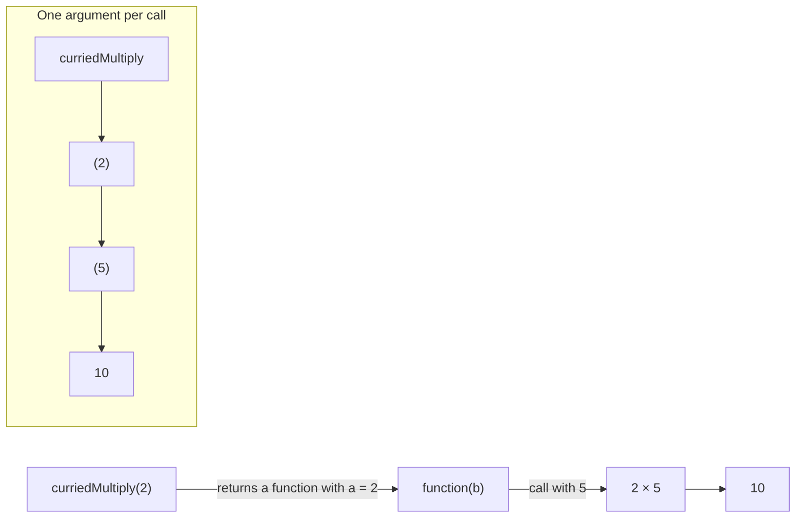
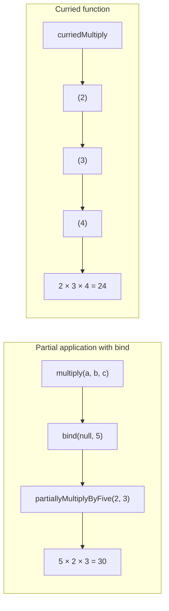

# Currying in JavaScript

## What is currying?

**Currying** transforms a function that takes multiple arguments into a
sequence of functions, each taking one argument. Instead of calling a function
with all arguments at once, you call the returned functions one at a time.

```js
// Uncurried: both arguments are passed in one call.
const multiply = (a, b) => a * b;
multiply(2, 5); // 10

// Curried: one argument is passed in each call.
const curriedMultiply = (a) => (b) => a * b;
curriedMultiply(2)(5); // 10
```

In the curried version, `curriedMultiply(2)` returns a function that remembers
`a` as `2`. Calling that returned function with `5` produces the result.

## Diagram



## Creating specialized functions

Currying lets you create a reusable function with one argument already
provided:

```js
const curriedMultiply = (a) => (b) => a * b;

const multiplyByTwo = curriedMultiply(2);
const multiplyByThree = curriedMultiply(3);

console.log(multiplyByTwo(5));   // 10
console.log(multiplyByThree(5)); // 15
```

`multiplyByTwo` and `multiplyByThree` are functions returned by
`curriedMultiply`. They retain their respective values of `a` through
closures.

## Currying versus partial application

These concepts are related but not identical:

- **Currying** changes a function's shape into nested, one-argument functions:
  `f(a, b)` becomes `f(a)(b)`.
- **Partial application** fixes some arguments of a function and returns a
  function for the remaining arguments. The returned function may accept more
  than one argument.

The curried `curriedMultiply(2)` example is also a way to partially apply the
first value, but currying specifically describes the one-argument-at-a-time
function structure.

## Partial application with `bind` and currying

The following examples show two ways to fix some arguments ahead of time:

```js
const multiply = (a, b, c) => a * b * c;

// Partial application with bind: fix the first argument as 5.
const partiallyMultiplyByFive = multiply.bind(null, 5);
console.log(partiallyMultiplyByFive(2, 3)); // 30 (5 * 2 * 3)

// Curried version: supply one argument in each call.
const curriedMultiply = (a) => (b) => (c) => a * b * c;
console.log(curriedMultiply(2)(3)(4)); // 24 (2 * 3 * 4)
```

`bind` creates a new function with its `this` value set to `null` and its first
argument fixed at `5`. The returned function still accepts the remaining two
arguments together. Currying instead creates nested functions, each accepting
one argument. Both techniques can defer some work until later calls, but they
are not the same operation.



## When is currying useful?

- **Specialization:** make functions such as `multiplyByTwo` from a general
  operation.
- **Reuse:** configure an operation once, then call the resulting function
  with different values.
- **Composition:** create functions with a consistent one-argument interface
  that can be easier to combine with other functional utilities.

Currying is a technique, not a requirement. Use it when the staged calls make
the code clearer; for simple operations, a regular multi-argument function may
be easier to read.