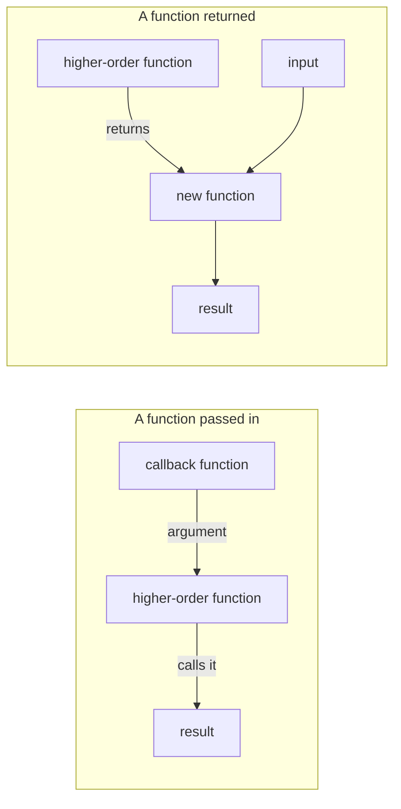

# Higher-Order Functions in JavaScript

## What is a higher-order function?

JavaScript treats functions as **first-class values**. You can assign a
function to a variable, pass it to another function, and return it from a
function.

A **higher-order function (HOF)** does at least one of these:

1. Accepts one or more functions as arguments.
2. Returns a function as its result.

The function passed into a HOF is often called a **callback**. The callback
may run immediately or later, depending on the HOF.

## Diagram



## HOF that accepts a function

This is the same pattern as `hof` in [app.js](./app.js):

```js
const hof = (fn) => fn(5);

const result = hof((number) => number * 2);
console.log(result); // 10
```

Here, `hof` is the higher-order function because it receives `fn`, a function.
The arrow function `(number) => number * 2` is the callback. `hof` calls the
callback with `5`, and the callback's return value becomes the result.

The callback does not have to be anonymous:

```js
function square(number) {
  return number * number;
}

console.log(hof(square)); // 25
```

## HOF that returns a function

A function is also higher-order if it returns another function:

```js
function makeMultiplier(multiplier) {
  return function multiply(number) {
    return number * multiplier;
  };
}

const double = makeMultiplier(2);
console.log(double(5)); // 10
```

`makeMultiplier` returns `multiply`, and `multiply` retains access to
`multiplier` from its outer scope. That retained access is a **closure**.
Returning a function makes `makeMultiplier` a HOF; retaining the outer
variable is what makes the returned function a closure.

## Built-in higher-order functions

Array methods such as `map`, `filter`, and `reduce` accept callback functions:

```js
const numbers = [1, 2, 3, 4];

const doubled = numbers.map((number) => number * 2);
const evens = numbers.filter((number) => number % 2 === 0);
const sum = numbers.reduce((total, number) => total + number, 0);

console.log(doubled); // [2, 4, 6, 8]
console.log(evens);   // [2, 4]
console.log(sum);     // 10
```

Each method is a HOF because it receives a callback. The callback describes
the operation for each value (or, for `reduce`, how to accumulate a result).
`map` and `filter` return new arrays; `reduce` returns the accumulated value.

## Closures and retained state

A closure can retain local state after its outer function has finished:

```js
function createCounter() {
  let count = 0;

  return function increment() {
    count += 1;
    return count;
  };
}

const increment = createCounter();
console.log(increment()); // 1
console.log(increment()); // 2
```

`createCounter` is a HOF because it returns a function. `increment` is a
closure because it can still access `count`. Each call updates the private
state, so the result depends on the call history; the function is stateful and
is not referentially transparent.

Not every closure changes state. For example, a closure that only reads a
captured value does not update that value:

```js
function createCountReader() {
  const count = 3;
  return function getCount() {
    return count;
  };
}

const getCount = createCountReader();
console.log(getCount()); // 3
```

## Why use higher-order functions?

- **Reuse:** pass different callbacks to the same general operation.
- **Composition:** build larger transformations from small functions.
- **Clarity:** methods such as `filter` and `map` express what to do with a
  collection without writing the iteration mechanics each time.
- **Abstraction:** keep a reusable operation separate from the specific
  behavior supplied by its callback.

## Quick check

Ask: **Does this function receive a function argument, return a function, or
both?** If yes, it is a higher-order function. A function passed as an argument
is a callback, and a function that retains access to variables from its outer
scope is a closure. These terms describe related but different concepts.