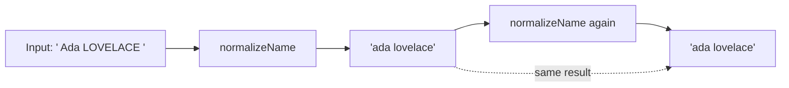

# Idempotence

In functional programming, a function is **idempotent** when applying it more
than once has the same result as applying it once:

```text
f(f(x)) = f(x)
```

In other words, after the first application, applying the function again does
not change the result.

## Example: normalizing a name

This function trims whitespace and converts text to lowercase. Once a string is
normalized, normalizing it again leaves it unchanged.

```js
function normalizeName(value) {
  return value.trim().toLowerCase();
}

const input = "  Ada LOVELACE  ";
const once = normalizeName(input);
const twice = normalizeName(once);

console.log(once);  // "ada lovelace"
console.log(twice); // "ada lovelace"
console.log(once === twice); // true
```

The function is idempotent because:

```js
normalizeName(normalizeName(input)) === normalizeName(input);
```

## Diagram



The second application receives the first result and produces that same
normalized value.

## Use case: HTTP API calls

Idempotence matters when a client retries a request after a timeout or
connection failure. The server might have completed the first request even
though the client did not receive its response. Retrying an idempotent request
should leave the server in the same state as making it once.

For example, `PUT` can set a resource to a specific state:

```js
async function setUserName(userId, name) {
  const response = await fetch(`/api/users/${userId}`, {
    method: "PUT",
    headers: { "Content-Type": "application/json" },
    body: JSON.stringify({ name }),
  });

  if (!response.ok) {
    throw new Error(`Could not update user: ${response.status}`);
  }

  return response.json();
}

await setUserName("42", "Ada");
await setUserName("42", "Ada"); // same requested state; no extra name change
```

Sending the same `PUT` repeatedly sets the user's name to `"Ada"` each time,
rather than applying another change each time. This assumes the endpoint is
designed to replace/set that resource state; incidental effects such as audit
records may still occur on each request.

Common HTTP method behavior:

| Method | Idempotent? | Typical behavior |
| --- | --- | --- |
| `GET` | Yes | Reads a resource without changing its state. |
| `PUT` | Yes | Creates or replaces a resource at a known URL with the supplied state. |
| `DELETE` | Yes | Leaves the resource deleted; later responses may differ, such as `204` then `404`. |
| `POST` | Usually no | Often creates a new resource, so retrying may create duplicates. |

Idempotence describes the intended effect on server state, not necessarily
identical response codes or the absence of every logging or monitoring side
effect. A `POST` endpoint can support safe retries by accepting an idempotency
key and storing the result for that key, so repeated requests with the same key
do not create multiple resources. The server must implement this behavior; a
client-generated key alone does not make a request idempotent.

## Idempotence is not the same as determinism

A deterministic function returns the same output each time it receives the
same input. Idempotence is a different property: feeding a function's output
back into the function does not change it.

For example, `Math.abs` is idempotent:

```js
Math.abs(Math.abs(-5)) === Math.abs(-5); // true
```

But an increment function is not:

```js
function increment(number) {
  return number + 1;
}

increment(increment(5)); // 7
increment(5);            // 6
```

Calling a function repeatedly with the same argument is not enough to prove
idempotence. For example, `Math.random()` can return different values, and
logging the same value repeatedly still performs a new logging side effect each
time.

## Why it matters

Idempotent operations are useful when an operation may be retried: repeating it
does not keep changing the result after the first successful application.
Examples include normalizing data and setting a resource to a specific state.
Whether an operation is idempotent depends on its observable effects, not only
on whether its return value looks the same.