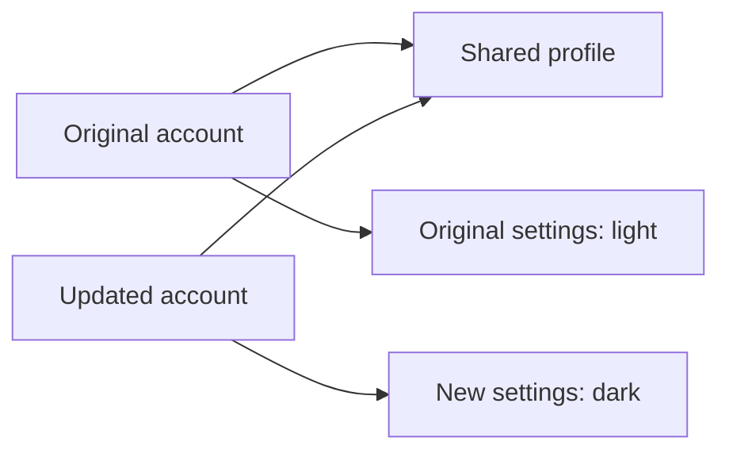

# Immutability and Structural Sharing

**Immutability** means treating existing data as read-only. When a value needs
to change, create an updated value instead of changing the original object or
array. This makes changes easier to track and reduces unexpected side effects.

In JavaScript, `const` prevents rebinding a variable, but it does **not** make
the object or array it references immutable:

```js
const user = { name: "Ada" };
user.name = "Grace"; // Allowed: the object itself was mutated.
```

Immutability is a coding practice unless you use additional protections or
immutable-data libraries. The examples below follow that practice by creating
new values.

## Updating an object without mutation

```js
const user = {
  name: "Ada",
  preferences: {
    theme: "light",
    notifications: true,
  },
};

function setTheme(currentUser, theme) {
  return {
    ...currentUser,
    preferences: {
      ...currentUser.preferences,
      theme,
    },
  };
}

const updatedUser = setTheme(user, "dark");

console.log(user.preferences.theme);        // "light"
console.log(updatedUser.preferences.theme); // "dark"
console.log(updatedUser !== user);          // true
console.log(updatedUser.preferences !== user.preferences); // true
console.log(updatedUser.name === user.name); // true
```

Each object on the path to the changed value is copied. The original objects
remain unchanged.

## What is structural sharing?

**Structural sharing** is reusing references to parts of a data structure that
did not change while creating new objects or arrays for the parts that did.
In the example above, the new user and `preferences` objects are created, but
the unchanged `name` value is reused.

For nested data, unchanged nested objects can also be shared:

```js
const account = {
  profile: { name: "Ada" },
  settings: { theme: "light" },
};

const nextAccount = {
  ...account,
  settings: {
    ...account.settings,
    theme: "dark",
  },
};

console.log(nextAccount !== account); // true
console.log(nextAccount.settings !== account.settings); // true
console.log(nextAccount.profile === account.profile); // true: unchanged branch shared
```



Sharing unchanged data can reduce copying and memory use compared with cloning
the entire structure. It is also why shallow copies must be handled carefully:
`{ ...object }` and `[...array]` create only a **shallow** copy. Nested
objects and arrays still point to the same references unless those branches
are copied too. Mutating a shared nested value would affect both structures.

## Updating an array

Use methods that return a new array, such as `map`, `filter`, and spread,
instead of changing the existing array with methods such as `push`, `pop`, or
`splice`.

```js
const todos = [
  { id: 1, title: "Read", done: false },
  { id: 2, title: "Practice", done: false },
];

const nextTodos = todos.map((todo) =>
  todo.id === 1 ? { ...todo, done: true } : todo
);

console.log(todos[0].done); // false
console.log(nextTodos[0].done); // true
console.log(nextTodos[1] === todos[1]); // true: unchanged item shared
```

The array and changed item are new; the unchanged item is structurally shared.

## Use case: updating application state

When a UI or state-management system keeps previous state snapshots, immutable
updates make it straightforward to compare old and new state, implement undo,
and avoid changes appearing in places that reuse the old state. For example,
marking one todo complete creates a new array and a new object for that todo,
while leaving the previous `todos` value intact.

For structural sharing to be safe, do not later mutate any shared object or
array. Treat previous and current snapshots as read-only, and create new values
for every changed branch.