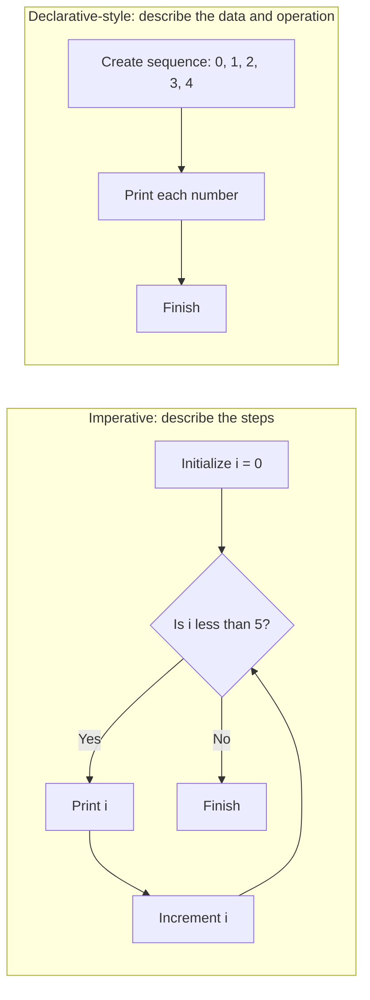

# Imperative vs. Declarative Programming

Imperative and declarative programming are two ways to express a solution:

- **Imperative** code describes *how* to do something, step by step. It often
  uses statements that update variables or control flow, such as loops.
- **Declarative** code describes *what* result or transformation is wanted,
  using operations that express the intent.

## Example: print the numbers from 0 to 4

### Imperative approach

The loop explicitly manages the counter, checks the stopping condition, and
increments the counter.

```js
for (let i = 0; i < 5; i++) {
  console.log(i);
}
```

### Declarative-style approach

This version first describes a sequence of five numbers, then says to print
each number.

```js
const numbers = Array.from({ length: 5 }, (_, index) => index);

numbers.forEach((number) => {
  console.log(number);
});
```

Both examples print `0`, `1`, `2`, `3`, and `4`. The difference is how the
intent is expressed: the loop spells out the iteration mechanics, while the
array version works with a collection and applies an operation to each item.
The declarative-style version still uses concrete steps internally; the
distinction is about what the code emphasizes, not whether steps exist at all.

## Diagram



## When to use each

- Use an imperative approach when explicit control over each step makes the
  logic clearer, such as when managing complex state or early exits.
- Use a declarative approach when a collection operation clearly communicates
  the desired transformation or result.

Neither style is always better. Choose the one that makes the code easiest to
understand and maintain; JavaScript programs commonly combine both styles.