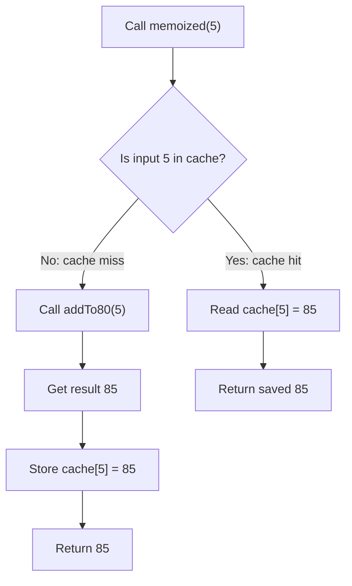

# Memoization in JavaScript

## What is memoization?

**Memoization** is an optimization technique that stores the result of a
function call and reuses it when the function is called again with the same
input. This can avoid repeating expensive calculations.

Memoization is most useful for functions that are deterministic: the same
input must produce the same output, and the function should not depend on
changing external state or perform required side effects.

## Example: caching `addTo80`

The [index.js](./index.js) example defines a function that adds `80` to its
argument:

```js
function addTo80(n) {
  console.log("Take a long time to compute");
  return n + 80;
}
```

Calling `addTo80(5)` more than once repeats the work. A cache can store the
result by input:

```js
const cache = {};

function memoizedAddTo80(n) {
  if (n in cache) {
    return cache[n]; // Cache hit: reuse the saved result.
  }

  console.log("Computing and caching result...");
  cache[n] = addTo80(n); // Cache miss: compute and save it.
  return cache[n];
}

memoizedAddTo80(5); // Computes 85 and stores it under key 5.
memoizedAddTo80(5); // Returns the cached 85 without calling addTo80 again.
```

The code in `index.js` also wraps the cache in `memoize()`. This keeps the
cache in the returned function's closure rather than in a global variable:

```js
function memoize() {
  const cache = {};

  return function (n) {
    if (n in cache) {
      return cache[n];
    }

    console.log("Computing and caching result...");
    cache[n] = addTo80(n);
    return cache[n];
  };
}

const memoized = memoize();
memoized(5); // Calculates and caches 85.
memoized(5); // Reuses the cached 85.
```

Each call to `memoize()` creates a separate cache. The returned function
retains access to its cache through a **closure**.

## Diagram



The first call is a **cache miss**, so the wrapped function runs and its result
is stored. A later call with the same input is a **cache hit**, so the saved
result is returned.

## Important considerations

- **Inputs must identify the calculation.** If the result depends on more
  than one argument, the cache key must represent all relevant arguments.
- **The function's result must remain valid.** If a function depends on
  changing state, time, or external data, returning an old cached value may be
  incorrect.
- **Caches use memory.** An unbounded cache can grow as new inputs arrive.
  Applications may need a size limit or an eviction policy.
- **Cache keys need care.** The simple object cache in this example is suitable
  for its numeric inputs. For general keys, `Map` can avoid object-property
  key coercion and inherited-property concerns; a memoizer must still define
  how it represents multiple arguments.

Memoization does not make the first call faster. It can reduce repeated work
when the same input occurs again, trading additional memory for saved
computation.